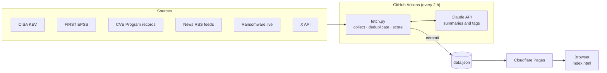

<p align="center">
  <picture>
    <source media="(prefers-color-scheme: dark)" srcset="vulforce-logo-dark-bg.png">
    
  </picture>
</p>

<p align="center">
  <b>Exploited vulnerabilities and threat news, ranked.</b><br>
  A free, automated cyber threat intelligence (CTI) digest that tells a security analyst, in about a minute, what to look at first.
</p>

<p align="center">
  <a href="https://vulforce.com">vulforce.com</a> ·
  <a href="#features">Features</a> ·
  <a href="#architecture">Architecture</a> ·
  <a href="#getting-started">Getting started</a> ·
  <a href="#scoring-model">Scoring model</a>
</p>

---

## Table of contents

1. [Motivation](#motivation)
2. [Features](#features)
3. [Architecture](#architecture)
4. [Tech stack](#tech-stack)
5. [Data sources](#data-sources)
6. [Scoring model](#scoring-model)
7. [Use of AI](#use-of-ai)
8. [Project structure](#project-structure)
9. [Getting started](#getting-started)
10. [Configuration](#configuration)
11. [Running costs](#running-costs)
12. [Design decisions](#design-decisions)
13. [Security considerations](#security-considerations)
14. [Testing](#testing)
15. [Limitations](#limitations)
16. [Roadmap](#roadmap)
17. [Credits and licences](#credits-and-licences)
18. [Author](#author)

---

## Motivation

A CTI analyst starts the day with the same questions: *which vulnerabilities are attackers using right now, which of them matter most, and what is the security community talking about?* The answers are spread across CISA advisories, scoring databases, news sites, ransomware leak-site trackers and dozens of accounts on X.

Vulforce collects these public sources every two hours, ranks every item with transparent rules, and shows the result on one page in three colours:

| Colour | Meaning |
| --- | --- |
| 🔴 Red | Act now |
| 🟠 Orange | Check this week |
| 🟢 Green | Good to know |

It is a personal project built while studying software engineering. It also works as a small, end-to-end example of the CTI lifecycle: **collection → processing → analysis → dissemination**.

## Features

| Tab | What it does |
| --- | --- |
| **Brief** | Daily list of exploited vulnerabilities and security news, sorted into red, orange and green. Each item can be expanded to show *why* it got its score. An AI note lists the three items to look at first. |
| **CTI** | Analytics workbench: new exploited vulnerabilities per day, CVSS and EPSS distributions, most affected vendors, weakness types (CWE), CISA patch deadlines, news themes, threat actors and malware named in the news, and ATT&CK tactics. Every bar opens the items behind it. Export as a CVE list, CSV, JSON or a printable PDF summary. |
| **Map** | Interactive 3D globe of ransomware victims per country (last 30 days), plus a live ticker of the latest claims and pop-up profiles of the most active ransomware groups. |
| **Feed** | Recent posts from 20 selected security accounts on X (news, CTI teams, vulnerability researchers, official agencies), with CVE tagging and an AI summary that groups the posts into themes and cites the source posts. |
| **About** | Data sources, the full scoring method, how AI is used, and the known limits. |

Other details:

- Updates every 2 hours. An open page checks for new data every 10 minutes, so it can stay open on a second screen.
- Works on phones, respects the "reduce motion" accessibility setting, and has no tracking or cookies.
- Search engine and social-sharing metadata (structured data, Open Graph, sitemap).

## Architecture

Vulforce is a **static site with a scheduled data pipeline**. There is no server and no database: GitHub Actions runs a Python collector on a schedule, the collector writes one JSON file, and a single HTML page renders it in the browser.



**One run of the collector, step by step**

1. **Collect.** Download the CISA Known Exploited Vulnerabilities catalogue, EPSS scores, CVSS scores, four news feeds, ransomware claims and new X posts. Each source is fetched independently, so one failing source never stops the others. Its status is shown in the site footer.
2. **Process.** Parse RSS and Atom feeds, group stories about the same event (shared CVE or similar headline), and extract CVE IDs, threat actor names and signals such as "zero-day" or "ransomware".
3. **Score.** Apply the fixed rules in the [scoring model](#scoring-model) and assign a colour.
4. **Enrich (optional).** Ask Claude for short summaries, tags and the daily notes. Results are cached in `data.json` so the same item is never sent twice.
5. **Publish.** Write `data.json` only if something changed. The commit triggers a Cloudflare Pages deployment.

## Tech stack

| Layer | Technology | Why |
| --- | --- | --- |
| Data pipeline | Python 3.12, **standard library only** | No dependencies to install, update or audit |
| Scheduling | GitHub Actions (cron) | Free, versioned, logs every run |
| Hosting | Cloudflare Pages | Free static hosting with a global CDN and HTTPS |
| Front end | One `index.html`: HTML, CSS and vanilla JavaScript | No build step, no framework, loads fast |
| 3D globe | [globe.gl](https://github.com/vasturiano/globe.gl) (Three.js), loaded only when the Map tab is opened | Keeps the first page light |
| AI | Anthropic Claude API (`claude-haiku-5-5`) | Cheap, fast model for summarisation and tagging |
| Fonts | Archivo, IBM Plex Sans, IBM Plex Mono (Google Fonts) | |

## Data sources

| Source | Used for | Access |
| --- | --- | --- |
| [CISA KEV catalogue](https://www.cisa.gov/known-exploited-vulnerabilities-catalog) | Confirmed exploited vulnerabilities, required action, due date, ransomware use, CWE | Public JSON |
| [FIRST EPSS](https://www.first.org/epss/) | Probability of exploitation in the next 30 days | Public API |
| [CVE Program records](https://www.cve.org) (incl. CISA Vulnrichment) | CVSS severity score and vector | Public GitHub repository |
| BleepingComputer, The Record, The Hacker News, CISA advisories | Security news (headline, date and link only) | RSS / Atom |
| [Ransomware.live](https://www.ransomware.live) | Ransomware claims by country, group and sector | Public API |
| [X](https://x.com) | Posts from 20 security accounts | X API (paid, optional) |

Vulforce is not affiliated with any of these organisations.

## Scoring model

Every item gets a score from 0 to 100. **The score is computed by fixed rules, never by AI**, and the site shows each rule that contributed.

**Exploited vulnerabilities** (added to CISA KEV in the last 30 days)

| Rule | Points |
| --- | --- |
| Confirmed exploited (listed in KEV) | 50 |
| EPSS probability × 25 | 0–25 |
| CVSS 9.0+ / 7.0–8.9 | 10 / 5 |
| Used in ransomware campaigns | 15 |
| Added in the last 7 / 14 days | 10 / 5 |
| Mentioned in this week's news | 5 |

**News stories** (last 3 days)

| Rule | Points |
| --- | --- |
| Reported by a tracked source | 20 |
| Headline signals: zero-day, exploited, ransomware, supply chain, breach, critical flaw | up to 40 |
| Mentions a CVE that is in KEV | 20 |
| Covered by more than one source | 10 each, up to 20 |

**Thresholds**

| Colour | Vulnerabilities | News |
| --- | --- | --- |
| Red | 70+ | 60+ |
| Orange | below 70 | 40–59 |
| Green | never (everything in KEV is already exploited) | below 40 |

Weights, thresholds and keyword lists are constants at the top of `fetch.py`.

## Use of AI

AI is used to **summarise and tag**, never to **rank**. Everything written by AI is marked with an `AI` label on the site.

| Where | What Claude does |
| --- | --- |
| News stories | Two-line summary; sector, countries, threat actors, malware and MITRE ATT&CK tactic |
| Brief | The three items to look at first, chosen from the already-ranked top ten |
| Map | Short profiles of ransomware groups, written only from Ransomware.live's notes |
| Feed | Groups recent X posts into 3–5 themes and cites the posts each theme is based on |

Safeguards:

- Prompts treat all feed text as **untrusted data** and tell the model to ignore instructions inside it (prompt injection).
- Model output is parsed as JSON, validated and length-limited. Invented post IDs, tactics or CVE formats are discarded.
- The colour of a Feed theme comes from the posts it cites, not from the model.
- Without an API key, the site still works; the AI parts are simply hidden.

## Project structure

```
.
├── index.html                  # The whole site: markup, styles and scripts
├── fetch.py                    # Data collector, scorer and AI enrichment
├── data.json                   # Output of fetch.py (written by GitHub Actions)
├── countries.json              # Country outlines for the globe (Natural Earth)
├── globe.gl.min.js             # 3D globe library
├── .github/workflows/
│   └── update.yml              # Runs fetch.py every 2 hours
├── favicon.*, icon-*.png,      # Icons for browsers, Google and phones
│   apple-touch-icon.png,
│   site.webmanifest
├── vulforce-logo-*, vulforce-mark-*   # Logo kit
├── og-image.png                # Preview image for shared links
├── robots.txt, sitemap.xml     # Search engine files
└── markus.jpeg                 # Photo on the About page
```

## Getting started

### Prerequisites

- Python 3.10 or newer (no packages needed)
- A GitHub account; optionally a Cloudflare account and API keys (see [Configuration](#configuration))

### Run locally

```bash
git clone https://github.com/KankareDEV/<repository>.git
cd <repository>

python fetch.py              # collects the data and writes data.json
python -m http.server 8000   # serves the site
```

Open <http://localhost:8000>. Opening `index.html` directly from disk does not work, because browsers block a local file from reading `data.json`.

### Deploy

1. Push the repository to GitHub (including the hidden `.github` folder).
2. Under **Settings → Actions → General → Workflow permissions**, choose *Read and write permissions* so the workflow can commit `data.json`.
3. In Cloudflare, go to **Workers & Pages → Create → Pages → Connect to Git**, select the repository, choose framework *None* and leave the build command empty.
4. Run the workflow once: **Actions → Update data → Run workflow**.
5. Optional: add a custom domain under the Pages project's **Custom domains**.

## Configuration

### Secrets

Add these under **Settings → Secrets and variables → Actions**. All are optional; each one switches on a part of the site.

| Secret | Enables |
| --- | --- |
| `ANTHROPIC_API_KEY` | AI summaries, tags, daily notes, group profiles and the Feed summary |
| `X_BEARER_TOKEN` | The Feed tab (posts from X) |

Keys are passed to the collector only as environment variables in GitHub Actions. They are never written to the repository or sent to the browser.

### Settings in `fetch.py`

| Constant | Default | Meaning |
| --- | --- | --- |
| `KEV_WINDOW_DAYS` | 30 | How far back exploited vulnerabilities are shown |
| `NEWS_WINDOW_DAYS` | 3 | How far back news is shown |
| `VULN_RED`, `NEWS_RED`, `NEWS_ORANGE` | 70, 60, 40 | Colour thresholds |
| `FEEDS` | 4 feeds | News sources |
| `WATCHLIST` | 23 names | Threat actors and malware looked for in the news |
| `AI_MAX_STORIES_PER_RUN` | 40 | Cap on new stories sent to Claude per run |
| `X_ACCOUNTS` | 20 accounts | Accounts shown on the Feed tab |
| `X_MAX_READS_PER_DAY` | 100 | Daily cap on X posts read (controls cost) |
| `X_KEEP_HOURS` | 72 | How long an X post stays on the site |

The update schedule is the `cron` line in `.github/workflows/update.yml` (`7 */2 * * *`, every two hours).

## Running costs

| Item | Cost per month |
| --- | --- |
| GitHub Actions, Cloudflare Pages | Free |
| Claude API (Haiku) | Well under $1 |
| X API (100 posts a day + weekly profile lookups) | About $16 at most |

Prices are the providers' published rates at the time of writing and can change. Spending limits are set in both the Claude Console and the X Developer Console.

Cloudflare Pages' free plan allows 500 builds a month. Every changed `data.json` is a build, so a two-hour schedule (at most about 372 runs a month) stays within the limit.

## Design decisions

- **Static site instead of a backend.** No server to patch, attack or pay for. The trade-off is that data is up to two hours old, which is acceptable for a daily digest.
- **Rules for ranking, AI for language.** Fixed rules make every ranking reproducible and explainable, which matters in security work. The AI only summarises and tags, and is labelled where it does.
- **Standard library only in Python.** Nothing to install in CI, no supply-chain risk from dependencies.
- **Cache everything that costs money.** CVSS scores, AI summaries and X posts are kept in `data.json` and reused. X is asked only for posts newer than the last one seen (`since_id`).
- **Fail soft.** Each source is independent. If one fails, the previous data for it is kept and the footer shows which source was unreachable.
- **Privacy by default.** Ransomware claims are stored only as counts per country, group and sector. Victim names are never stored, because leak-site posts are unverified claims by criminals.

## Security considerations

- All text from feeds and APIs is inserted into the page with `textContent`, never `innerHTML`, so it cannot inject HTML or scripts.
- Only `http(s)` links are rendered; anything else is replaced.
- API keys exist only as GitHub Actions secrets.
- AI prompts defend against prompt injection, and AI output is validated before use.
- The contact email is assembled in the browser after a click, to keep it away from simple spam crawlers.
- No cookies, analytics or third-party trackers.

## Testing

There is no automated test suite yet. Changes are verified by:

1. `python -m py_compile fetch.py` and a full local run of `python fetch.py`.
2. Unit-style checks of the parsers and scoring functions with recorded or synthetic API responses (feed parsing, duplicate merging, X `since_id` handling, AI output validation).
3. Rendering the site locally with Playwright at desktop and phone widths, checking for script errors and horizontal overflow.
4. Checking the source status list in the site footer after each deployment.

Adding a `pytest` suite for `fetch.py` is the first item on the roadmap.

## Limitations

- It ranks **general** risk and knows nothing about any organisation's own assets. A red item may not affect you, and a green one might.
- Headline keyword matching is simple and sometimes misjudges a story.
- Very new CVEs may have no CVSS or EPSS score yet.
- The map shows where victims are reported to be, not where attackers are. Ransomware figures are the groups' own claims.
- Threat actor detection uses a fixed watchlist plus AI tagging, so some names will be missed.
- AI summaries can be incomplete or wrong; the source is always linked.
- An X post that is edited or deleted can stay visible for up to 72 hours.

## Roadmap

- [ ] `pytest` suite for parsing and scoring
- [ ] History: "new since yesterday" and week-over-week trends
- [ ] MITRE ATT&CK mapping for vulnerabilities
- [ ] RSS feed and e-mail alert for red items
- [ ] Filter by vendor or product an organisation actually uses

## Credits and licences

- [globe.gl](https://github.com/vasturiano/globe.gl): MIT licence
- Country outlines: [Natural Earth](https://www.naturalearthdata.com), public domain
- Ransomware data: [Ransomware.live](https://www.ransomware.live). It must be credited wherever its data is shown and does not allow commercial use without permission.
- News headlines belong to their publishers; X posts belong to their authors and are shown following X's display requirements.

## Author

**Markus Kankare**, software engineering student (B.Sc., IU International University of Applied Sciences)

- GitHub: [@KankareDEV](https://github.com/KankareDEV)
- Website: [vulforce.com](https://vulforce.com)

Feedback and bug reports are welcome through GitHub issues.
